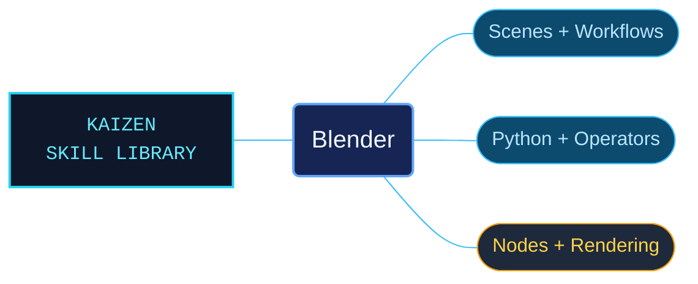

# Blender

Blender references that connect creative workflows with the Python APIs used to automate and extend them. Manual subjects, RNA types, operators, enumeration values and complete examples have distinct routes, making it easier to find the right level of detail for a task.

Use when working with Blender workflows or Python APIs: .blend files, bpy scripting, operators, add-ons, extensions, animation, rigging, modeling, geometry and shader nodes, materials, UVs, sculpting, painting, cameras, lighting, rendering, compositing, video editing, linked libraries, or user-interface controls. Use for exact Blender identifiers, parameters, shortcuts, context requirements and version-specific behavior. Not for other DCC applications or general Python unrelated to Blender.

## What this skill helps with

| Task | Useful reference material |
| --- | --- |
| [Navigate creative workflows](references/manual/INDEX.md) | Find modeling, animation, nodes, rendering, editors and file workflows. |
| [Understand Python integration](references/python-api/INDEX.md) | Use scripting guides and module references with their context requirements. |
| [Look up exact API contracts](references/python-api/types/INDEX.md) | Inspect RNA types and follow separate operator and enumeration catalogs. |
| [Adapt complete examples](references/python-api/examples/INDEX.md) | Find rendering, UI, USD, geometry and property-accessor examples with their supporting context. |

## The work behind the references

The manual and Python API are reorganized into descriptive subject trees. Naming, navigation and source-preservation checks accompanied repairs to identified examples and content boundaries, keeping code and the context required to interpret it connected.

## Start here

Start with [SKILL.md](SKILL.md) and follow its context routes.

Begin with [version and context guidance](references/blender-version-and-context.md). Match the installed Blender version, editor mode and operator context before adapting an example. Python modules under `references/` accompany the documentation; the root resource folders reserve space for future additions.

## Sources and license

Skill reference documentation is interpreted content for use in open source projects. Check against [official documentation sources](https://docs.blender.org/) when dealing with defects or issues that may come up from interpreting this skill's references.

Licensed under **AGPL-3.0**; see [LICENSE](LICENSE). Part of the [Agent Kaizen](https://github.com/LevyBytes/agent-kaizen) skill library.
